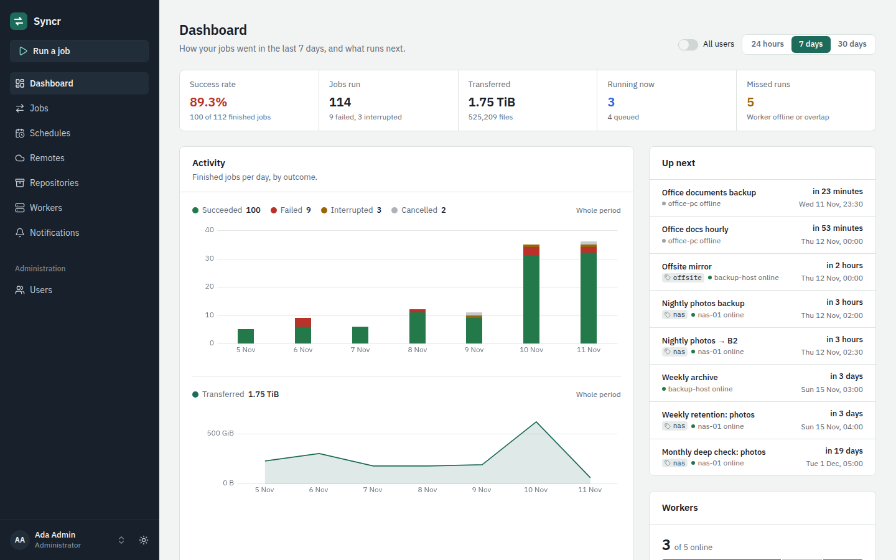
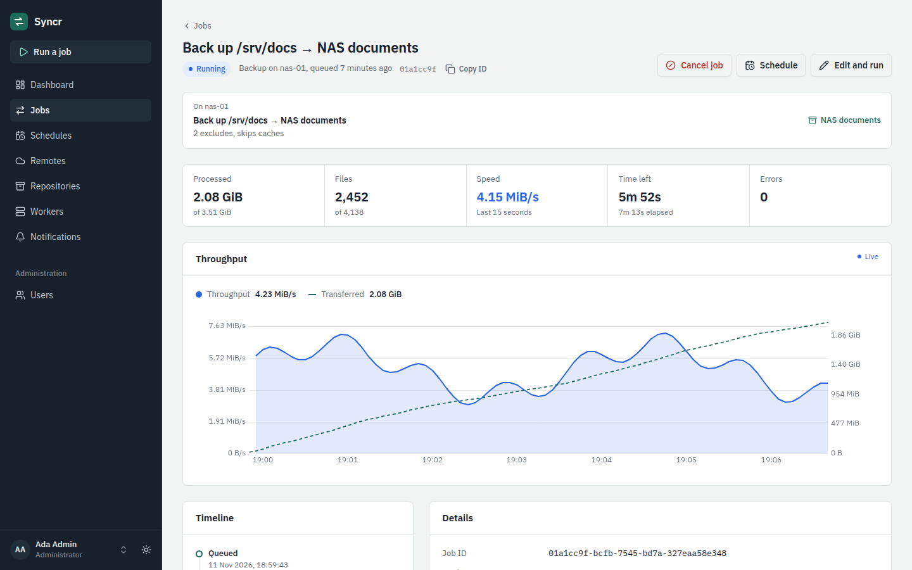
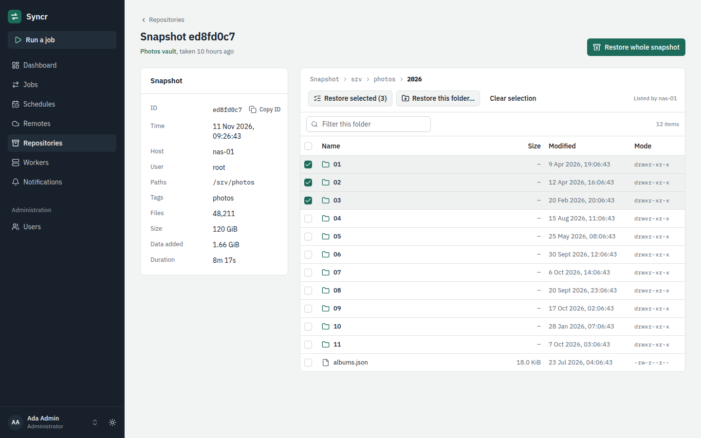
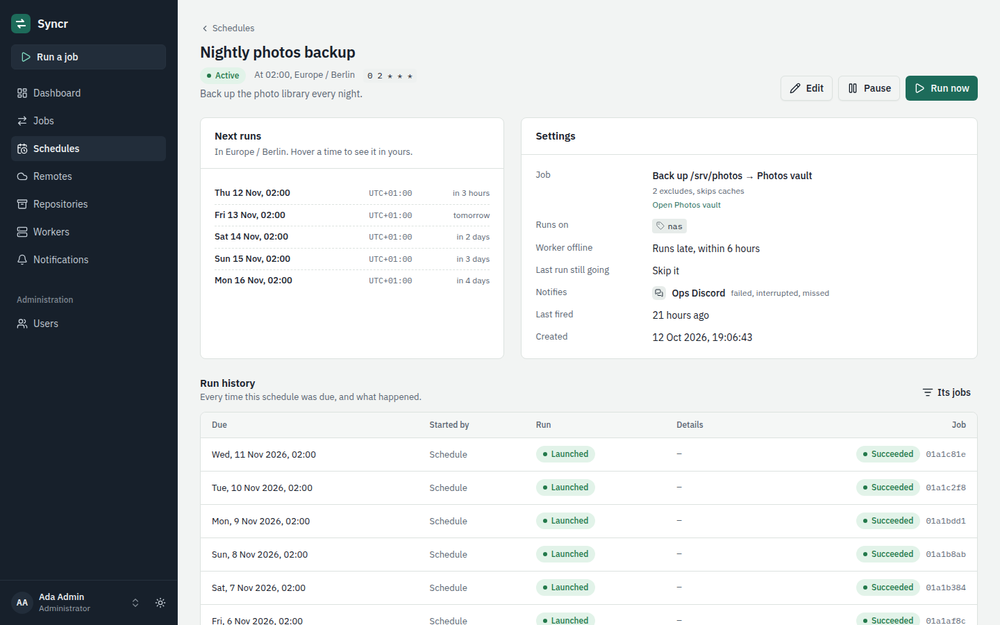
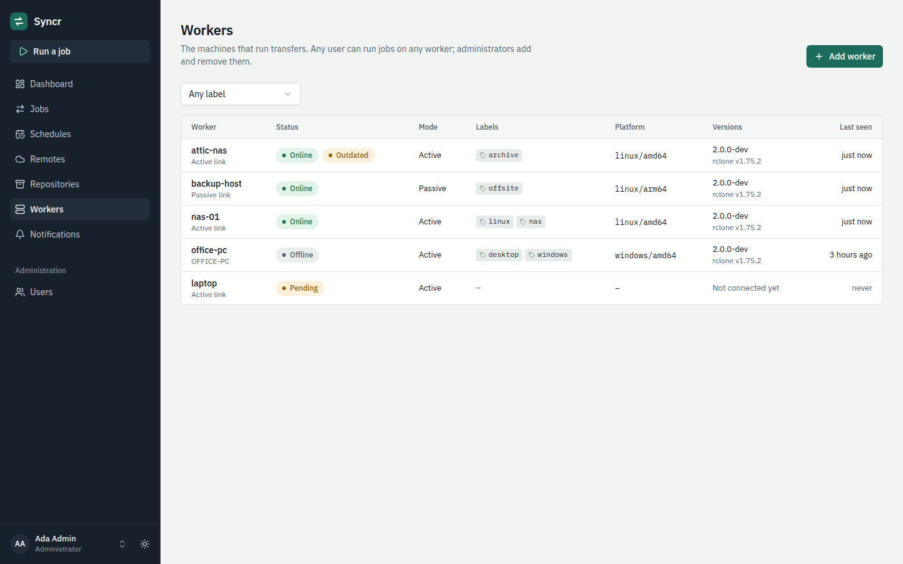

# Syncr

Self-hosted manager for [rclone](https://rclone.org/) transfers and
[restic](https://restic.net/) backups. One controller with a web UI drives
any number of workers on your servers and desktops (Linux and Windows):
run jobs by hand or on a schedule, watch them live, browse and restore
snapshots, and get notified when something fails.

<picture>
  <source media="(prefers-color-scheme: dark)" srcset="docs/screenshots/readme/dashboard-dark.png">
  
</picture>

## Features

- **rclone transfers.** Copy, sync or move between S3 and compatibles,
  SFTP, Backblaze B2, WebDAV, a worker's local folders and unions of them,
  with live progress, speed and time left.
- **restic backups.** Create or connect repositories on any remote, back up
  a worker's folders, apply retention and check them. Browse snapshots and
  restore all of one, a folder or selected files.
- **Hooks.** Run commands a worker's operator prepared before and after a
  job: dump a database, stop and start containers, ping a monitor.
- **Schedules.** Cron expressions with time zones and daylight-saving rules,
  run on one worker or on the least busy worker with a label, with policies
  for missed runs and overlaps.
- **Notifications.** Discord, email and signed webhooks (or Slack's format),
  stored before sending and retried, with a delivery log per contact.
- **Workers anywhere.** Workers connect to the controller (active) or the
  controller connects to them over pinned TLS (passive), install as a system
  or per-user service, and upgrade in place with automatic rollback.
- **Secure by default.** Credentials are encrypted at rest and only sent to
  the worker that runs the job; jobs can only touch the folders a worker
  allows (`local_roots`).
- **Multi-user.** Admin-created accounts, private remotes and schedules,
  personal API tokens, and a [Connect API](docs/api.md) for everything the UI
  does.

## Screenshots

<table>
  <tr>
    <td width="50%">
      <picture>
        <source media="(prefers-color-scheme: dark)" srcset="docs/screenshots/readme/job-live-dark.png">
        
      </picture>
      <p align="center">Following a job live</p>
    </td>
    <td width="50%">
      <picture>
        <source media="(prefers-color-scheme: dark)" srcset="docs/screenshots/readme/snapshot-browser-dark.png">
        
      </picture>
      <p align="center">Browsing and restoring a snapshot</p>
    </td>
  </tr>
  <tr>
    <td width="50%">
      <picture>
        <source media="(prefers-color-scheme: dark)" srcset="docs/screenshots/readme/schedule-dark.png">
        
      </picture>
      <p align="center">A schedule and its history</p>
    </td>
    <td width="50%">
      <picture>
        <source media="(prefers-color-scheme: dark)" srcset="docs/screenshots/readme/workers-dark.png">
        
      </picture>
      <p align="center">Workers on Linux and Windows</p>
    </td>
  </tr>
</table>

## Quick start

**1. Start the controller and Postgres** with Docker Compose:

```sh
mkdir syncr && cd syncr
v=v2.0.0
curl -fsSLo docker-compose.yml "https://raw.githubusercontent.com/Zeptiny/Syncr/$v/deploy/docker-compose.yml"
curl -fsSLo .env "https://raw.githubusercontent.com/Zeptiny/Syncr/$v/deploy/.env.example"
chmod 600 .env
# Fill in POSTGRES_PASSWORD (openssl rand -hex 24) and
# SYNCR_SECRETS_KEY (openssl rand -base64 32) in .env
docker compose up -d --wait
```

**2. Create the first admin.** Open <http://127.0.0.1:8080> and enter the
one-time setup code from the log:

```sh
docker compose logs controller | grep setup_code
```

**3. Add a worker.** In the UI open **Workers → Add worker** and run the
install command it shows on the machine that should run jobs. It enrolls,
installs the pinned rclone and restic, and starts the service.

**4. Add remotes and run jobs.** Store your storage under **Remotes**, then
use **Run a job**, or set up **Repositories** and **Schedules**.

Workers on other machines need the controller behind HTTPS, and you should
back up the database and `SYNCR_SECRETS_KEY`: see
[running the controller](docs/deployment.md).

## Supported platforms

| | |
|---|---|
| Controller | Docker image (Linux x86-64, ARM64) or binary (Linux x86-64/ARM64, Windows x86-64); PostgreSQL 17 |
| Workers | Linux x86-64/ARM64 with systemd (system or `--user`), or any Linux with `--no-service` or in the image; Windows 10 / Server 2016 or newer, x86-64 (service or `--user`) |
| Web UI | current Firefox, Chrome, Edge and Safari |

## Documentation

- [Running the controller](docs/deployment.md): HTTPS, backups, upgrades, images
- [Configuration](docs/configuration.md): every controller setting
- Workers: [Linux](docs/setup-linux.md), [Windows](docs/setup-windows.md),
  [configuration](docs/worker-config.md), [upgrading](docs/upgrade.md)
- [restic backups](docs/restic.md), [hooks](docs/hooks.md) and
  [notifications](docs/notifications.md)
- [Scripting the API](docs/api.md)
- [Development](docs/development.md): building, testing and the architecture
- [Release notes](docs/releases/) · [Security policy](SECURITY.md)
