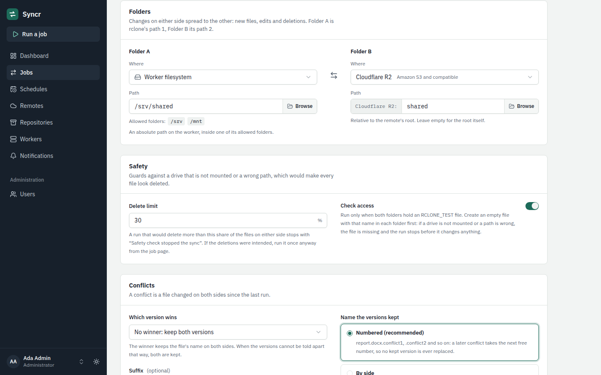
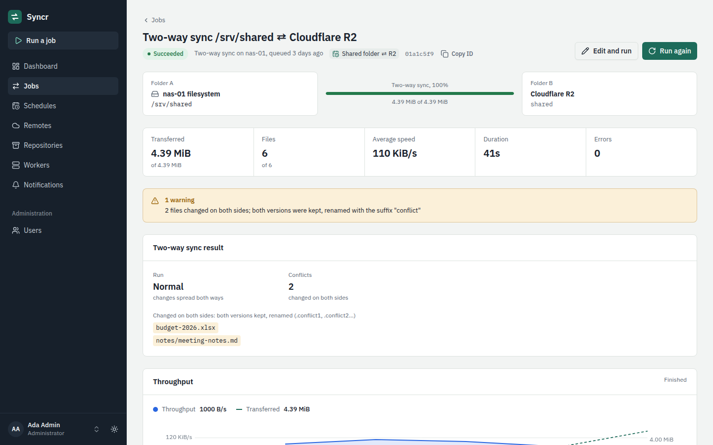
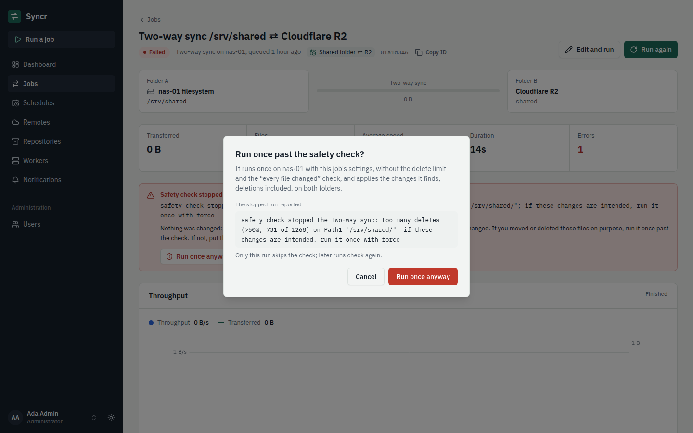

# Two-way sync

A **two-way sync** keeps two folders in step in both directions: files
created, changed or deleted on either side are created, changed or deleted
on the other at the next run. Each side is a folder on a worker or a path
on a remote. The typical case is one folder on two machines, a desktop and
a laptop, kept in step through a bucket that both reach.

The worker runs it with the pinned rclone's `bisync` command (1.75.2). In
the web UI it is the job kind **Two-way sync**; in the API and in hooks it
is `rclone_bisync`.

Design record: [ADR 0018](adr/0018-two-way-sync.md).

## Which job to use

| You want | Use |
|---|---|
| A copy of a folder somewhere else, updated as the source changes | a **copy** or **sync** transfer: one way, the source is the truth |
| The same folder on several machines, edited on more than one of them | a **two-way sync** |
| Older versions of your files, protection against mistakes and ransomware | a **restic backup** ([restic backups](restic.md)) |

A two-way sync is not a backup. A file you delete or break on one machine
is deleted or broken on the other after the next run. Pair it with a
backup (see [the last section](#pair-it-with-a-restic-backup)).

## How it works

A two-way sync job names two folders, **Folder A** and **Folder B** (rclone
calls them path 1 and path 2). The pair has **state**: after every run the
worker keeps a listing of both folders, and the next run compares each
folder with its listing to find what changed on that side since. Then it
applies those changes to the other side:

- a file that is new or changed on one side is copied to the other;
- a file deleted on one side is deleted on the other;
- a file changed on both sides is a **conflict**: by default both versions
  are kept, renamed (see [Conflicts](#conflicts)).

The state lives **on the worker that ran the pair** (see
[Where the state lives](#where-the-state-lives)). So:

- **A schedule of a two-way sync runs on one worker,** never on a label.
  The schedule form disables the label choice for this kind, and the API
  refuses it.
- You may run the same pair on another worker by hand. It is a new pair
  there, and its first run is a resync (or, if its folder there is empty,
  asks for one: see [the first runs](#example-a-desktop-and-a-laptop-through-cloudflare-r2)).

**Runs that share a folder wait for each other.** Two pairs with a folder
in common (the desktop's and the laptop's pairs, which share the bucket
path) never run at the same time: the newer job waits, marked *Waiting for
folder*, until the older one has ended, whichever worker each is on. The
same goes for two jobs of one pair, such as a scheduled run and a manual
resync.

## Example: a desktop and a laptop through Cloudflare R2

One folder, `Shared`, on a Linux desktop and a Windows laptop, kept in step
through an R2 bucket.

**1. Workers.** Install a worker on each machine ([Linux](setup-linux.md),
[Windows](setup-windows.md)) and allow the folder in its
[configuration](worker-config.md):

```yaml
# desktop: /etc/syncr/worker.yaml
local_roots:
  - /home/ada/Shared
```

```yaml
# laptop: C:\ProgramData\Syncr\worker.yaml
local_roots:
  - 'C:\Users\ada\Shared'
```

(`--local-root` does the same at setup.) Restart each worker after the
change. Both folders must exist.

**2. The bucket and its remote.** In Cloudflare, create a bucket (say
`ada-shared`) and an R2 API token with *Object Read & Write* on it. In
Syncr, under **Remotes, Add remote**, choose **Amazon S3 and compatible**:

| Field | Value |
|---|---|
| Provider | Cloudflare R2 |
| Access key ID, Secret access key | the token's |
| Endpoint | `https://<ACCOUNT_ID>.r2.cloudflarestorage.com` |
| Region | `auto` |
| Bucket | `ada-shared` |

If the token is limited to that one bucket, also turn on **Don't check or
create the bucket** (advanced settings). **Test remote** should list the
empty bucket.

**3. One schedule per machine.** Under **Schedules, New schedule**, choose
**Two-way sync**:

- **Folder A:** *On the worker*, `/home/ada/Shared` (the desktop's folder;
  **Browse** picks it).
- **Folder B:** the R2 remote, path `shared`.
- **Where it runs:** *A specific worker*, the desktop's.
- **When:** every 15 minutes, for example `*/15 * * * *`.

Then the same for the laptop: Folder A `C:\Users\ada\Shared`, Folder B the
same R2 remote and path `shared`, on the laptop's worker. Offset its
minutes (`7-59/15 * * * *`) so that the two rarely fire together; if they
do, one waits for the other.



**4. The first runs.** A pair's first run on a worker is a **resync**: a
union of both folders, done on its own (the job's result says *Resync:
first run*). The desktop's first run uploads its folder to the bucket. If
the laptop's folder already holds files, its first run downloads what it
lacks and uploads what only it has; the desktop picks those files up at
its next run. From then on, every run spreads new files, changes and
deletions both ways.

**A first run never fills an empty folder on its own.** An empty folder on
the worker looks the same as the mount point of a drive that is not
mounted, and filling that from the bucket would make every file of the
drive look deleted once it is back: the next run would delete them from
the bucket and the other machine. So if the laptop's folder is empty (a new
machine), its first run stops with **Resync required** before it changes
anything: "Folder A (path1) is empty; a first run does not fill an empty
folder on its own". Check that it is the right folder, and that its drive
is mounted if it is on one, then **Resync now** on that job's page or the
schedule's: it downloads the bucket's files.

- *Empty* means no entry at all. A hidden file counts as content, and so
  does a file the filters exclude.
- When both sides are worker folders and both are empty, there is nothing
  to fill, and the first run goes ahead (and copies nothing).
- A worker folder that does not exist fails the run with `not_found`, a
  resync included: rclone would create it.

A resync never deletes. Where a file exists on both sides with different
content, it keeps the **newer** version and overwrites the other, without
a conflict copy. If both machines already hold different versions of the
same files, back them up before the first runs, or start the second
machine with an empty folder and resync it from the bucket.

## Conflicts

A file changed on both sides between two runs is a conflict (a file
changed the same way on both sides is not). By default both versions are
kept and renamed with a numbered suffix: with Folder A on the machine and
Folder B in the bucket, `report.docx.conflict1` is this machine's version
and `report.docx.conflict2` the bucket's (the other machine's). Both
copies reach every side; `report.docx` itself is gone until you settle it.
Open both, keep what you want under the original name, and delete the
copies: the next runs spread that.

The job's page lists the conflicts (the count and the first 20 paths); its
warnings and notifications give the count.



The **Conflicts** panel changes this:

- **Which version wins:** none (the default, both kept), the newer, the
  older, the larger, the smaller, Folder A's or Folder B's. The winner
  keeps the name on both sides; the other version is still kept, renamed.
  When the property cannot decide (the same time or size), both are kept
  as with none. A version is never thrown away: rclone's "delete the
  loser" is not offered.
- **Name the versions kept:** *Numbered* (recommended) takes the next
  free number, so a later conflict of the same file adds
  `.conflict3` and `.conflict4`. *By side* always uses 1 for Folder A and 2
  for Folder B, so a later conflict of the same file **replaces** the
  earlier copies.
- **Suffix:** `conflict` by default. Two suffixes separated by a comma
  (`desktop,cloud`) name Folder A's and Folder B's versions; with *By side*
  the copies are then called `report.docx.desktop` and `report.docx.cloud`,
  without a number.

## Deletions and the safety checks

Deletions spread, so a folder that looks empty or emptied by mistake (a
drive that is not mounted, a wrong path) could empty the other side too.
Every run checks first, and stops without changing anything when a check
fails:

- **Delete limit** (Safety panel, default 50 %): a run that would delete
  more than this share of the files on either side stops with **Safety
  check stopped the sync** (`safety_abort`). The message gives rclone's
  counts, such as "too many deletes (>50%, 731 of 1268)".
- **Every file changed:** a run in which every file of one side changed
  stops the same way. It happens after a clock or time zone change, or in a
  folder of one file that was edited on both sides.
- **An empty side:** a folder that is empty now, although it held files at
  the last run, stops the run with **A folder looked unavailable**
  (`side_unavailable`). An empty mount point is the usual cause.
- **Resyncs:** rclone does not check for an empty side during a resync.
  The automatic first run checks worker folders itself and never fills an
  empty one (see [the first runs](#example-a-desktop-and-a-laptop-through-cloudflare-r2)),
  but **Resync now** fills an empty folder on purpose: mount the drive
  first (its dialog says so). For folders on drives, mount points and
  network shares, turn on **Check access**: it stops a resync too.
- **Check access** (off by default): a run goes ahead only if both
  folders hold the same `RCLONE_TEST` files, the first run included. If a
  drive is not mounted, its file is missing and the run stops with **A
  folder looked unavailable**. To set it up, create an empty file named
  `RCLONE_TEST` in one machine's folder and let the pairs run once without
  check access, which copies the file to the bucket and the other machine;
  then turn the option on in both schedules. (Turning it on or off needs no
  resync.)
- **A missing folder:** a folder that does not exist fails with
  `not_found`. On a bucket, the bucket must exist; the path inside it need
  not.

A run stopped by a safety check keeps the pair's state, so nothing needs a
resync.

## When a run fails

| Error | Why | What to do |
|---|---|---|
| **Safety check stopped the sync** (`safety_abort`) | The delete limit, or every file changed. | If you deleted or changed those files on purpose, **Run once anyway** on the job's or the schedule's page: one run that skips these two checks. If not, put the files back or fix the path; the next run checks again. |
| **A folder looked unavailable** (`side_unavailable`) | A side is empty, or the `RCLONE_TEST` files are missing. | Mount the drive, fix the path, or create the `RCLONE_TEST` files. Nothing overrides this check; the next run goes ahead once both folders are there. |
| **Resync required** (`resync_required`) | Only a resync lets the pair go on: the filters changed, a worker folder was empty on the pair's first run, or a critical error left no earlier state to go back to (see below). | Fix what the message names first (mount the drive, a file's permissions): a resync stops at the same error. Then **Resync now** on the job's or the schedule's page. |
| **Failed** (`execution_failed`) with "stopped with a critical error" | A critical error, such as a file the worker cannot read, after the pair has a good state to go back to. | Fix the cause the message names. The next run goes on from the pair's last good state, without a resync; until then each run fails the same way. |



**Resync now** runs the pair once with a resync: both folders are merged as
they are now, each gets the files it lacks, nothing is deleted, and a file
that differs keeps the newer version (or what **Resync mode** says).
Files deleted on one side since the last good run come back from the
other, and an empty folder is filled. Neither action changes the schedule:
its next runs are normal again.

Which settings the actions run:

- **On the schedule's page**, the schedule's current settings, on the
  worker it targets now. **Run once anyway** is offered there only while
  the schedule has the settings the stopped run had, since its dialog
  repeats that run's counts; after a change, the next run checks again
  (**Run now** starts it at once).
- **On a job's page**, that job's settings, on its worker, and only while
  it is the pair's newest run there and its schedule, if any, has not
  changed since. Otherwise the page points to the newer run or to the
  schedule.
- **Resync now** always runs for real, also from a dry-run definition: a
  dry run cannot rebuild the pair's state. **Run once anyway** keeps a dry
  run dry: it then reports what it would change past the check.

Things that make a run fail with **Resync required**:

- **Changed filters** (see below).
- **An empty worker folder on the pair's first run** (see
  [the first runs](#example-a-desktop-and-a-laptop-through-cloudflare-r2)).
- **A critical error before the pair has a state to go back to**, such as a
  file that cannot be read on the first normal run after a resync. The
  runs after it fail with "cannot find prior Path1 or Path2 listings" until
  the cause is fixed and the pair resynced.

Critical errors after that need no resync. **A file that cannot be read**,
for example one without read permission for the worker's account, is
retried three times, then stops the run with a critical error: the job
fails (`execution_failed`) and names the file. rclone keeps the listings of
the last good run, and once the file is fixed the next run goes on from
them, with no resync. Until then every run fails the same way: one
unreadable file stops the whole pair. Rarely, **a run stopped** (cancel,
time limit, worker stop) just as a file finished copying is recorded as a
critical error too; the next run goes on the same way.

## Filters and resync

The **Filters** panel takes include and exclude rules, as for transfers
(`*.tmp`, `.~lock.*#`, `/node_modules/**`). They apply to both sides: an
excluded file is neither copied nor deleted.

**Changing the filters needs a resync.** A newly excluded file would
otherwise look deleted. So the next run after a change, including removing
every rule, fails with **Resync required**, and so does every run after it
until **Resync now**. The schedule form says so when you save changed
filters; once that run has stopped, the schedule's page offers **Resync
now** (**Run now** starts the run at once). Plan filter changes for a
moment when you can start the resync.

The pair's state, filters included, belongs to the two locations on the
worker, not to one schedule or job: see [the limits](#limits-and-known-gaps).

## Other options

- **Compare files by:** size and modification time by default. Adding the
  checksum also detects changes by content where both sides have a hash
  in common; it is slower.
- **Resync mode:** what a resync keeps of a file that differs: the newer
  (default), the older, the larger, the smaller, Folder A's or Folder B's.
- **Advanced:** parallel transfers and checkers, a bandwidth limit,
  low-level retries, **Sync empty folders** (also create and delete empty
  folders), and **Dry run**, which reports what would change (and the
  conflicts it would find) without changing anything. A dry run leaves the
  pair's state alone, even on its first run.

A job of a two-way sync can also run [hooks](hooks.md), and has a time
limit like any job.

## Where the state lives

Each pair's state is a folder in the worker's data directory,
`<data_dir>/bisync/<key>/` (`/var/lib/syncr/bisync` for a Linux system
install, `%ProgramData%\Syncr\bisync` for a Windows service; see
[worker configuration](worker-config.md)). It holds rclone's listings of
both sides, about 100 to 150 bytes per file and up to six listing files per
pair, and the filters.

The key is computed by the controller from both locations: the worker
folder, or the remote (its backend, its settings other than secrets) and
the path. **A pair is new**, and its next run a resync, when:

- it runs on another worker;
- either location changes: another folder, path, remote, bucket or
  endpoint, or Folder A and Folder B swapped;
- **the remote's settings change**, other than its secret. Rotating an R2
  or S3 token changes its access key ID, which is a setting, so the next
  run of every pair on that remote is a resync. A new secret alone does not;
- its state was removed: the worker deletes the state of pairs that have
  not run for **180 days**, at startup and then daily.

Such a resync is a union and deletes nothing, but deletions since the
pair's last run come back; an empty worker folder makes it stop and ask
first, as on any first run. Deleting a pair's state folder by hand (while
it does not run) has the same effect: the next run starts over with a
resync.

A two-way sync may not use the state folder as a side, nor a folder inside
it or one that holds it (`path_not_allowed`), even when the worker's
`local_roots` covers its data directory.

## Limits and known gaps

- **Path length:** rclone names its state files after both full paths, so
  the two paths (the remote's root and the path, and the worker folder) may
  be at most 200 bytes together. Longer pairs are refused, with a message
  that says so: when you save them, or when they are about to run if the
  remote's root (a bucket and prefix) makes them longer.
- **Nested locations are not serialized.** Pairs on `R2:shared` and on
  `R2:shared/sub`, or a local remote and the worker folder it points to,
  run at the same time if their schedules say so. Don't nest two-way
  locations, and don't let a **transfer** write into a two-way folder: it
  does not wait for the pair either. Its files are picked up as changes by
  the next run.
- **One remote per bucket.** Runs wait for each other by remote and path,
  not by bucket. Two remotes for the same bucket path, for example one per
  Syncr user (remotes are their owner's), do not wait for each other, so
  the desktop's and the laptop's runs could overlap on the bucket. Keep the
  pairs of one folder under one user, with one remote.
- **One definition per pair of folders on a worker.** Two definitions of
  the same two locations on one worker (two schedules, a schedule and a job
  run by hand with other options, or two users' definitions of the same
  two worker folders) share the pair's state. With different filters they
  take turns stopping each other: each resync accepts its own filters, and
  the other's next run fails with **Resync required**. Nothing is deleted
  (rclone notices the change), but use one definition per pair.
- **Clocks and modification times.** Change detection and "newer" rely on
  modification times. Keep the machines' clocks right; a clock or time
  zone change can stop a run with "every file changed".
- **Backends without modification times** (some WebDAV servers): rclone
  warns, and then tells changes by size only. An edit that keeps a file's
  size is not noticed, even with checksums, when the two sides have no hash
  in common. Use a remote with modification times (S3 and R2, B2, SFTP, a
  worker folder) for two-way syncs.
- **Upper and lower case.** Windows and macOS file systems ignore case,
  buckets do not. Two files whose names differ only in case
  (`Report.docx`, `report.docx`) can sync into a bucket from Linux but
  collide on a Windows laptop.
- **Stopping a run.** On Linux the worker asks rclone to stop and gives it
  10 seconds; rclone finishes the transfers under way meanwhile, and is
  killed if they take longer. On Windows a cancel always kills it. A killed
  run is finished by the next one without a resync, but it can leave a
  partial file (`name.<hash>.partial`): the next run copies it across, and
  the run after removes it, so one extra run may be needed.
- **One unreadable file stops the pair** until it is fixed (see
  [when a run fails](#when-a-run-fails)).
- **A folder cannot be emptied through the sync:** an empty side stops the
  run (that is the unmounted-drive check). Keep at least one file in it.
- A run is not a snapshot: files that change while it runs are picked up
  by the next run.
- There is no preview yet that lists the files a run would change: a dry
  run only tells whether the run would go ahead, and the conflicts it would
  find.

## Pair it with a restic backup

A two-way sync spreads mistakes as faithfully as edits: a deleted folder,
a file overwritten with garbage, a resync that kept the wrong version.
Keep history next to it with a [restic backup](restic.md) of one of the
machines' folders (the desktop's `/home/ada/Shared`, say), on a schedule
and with a retention policy. Then any version can be restored, whatever
the sync did.
