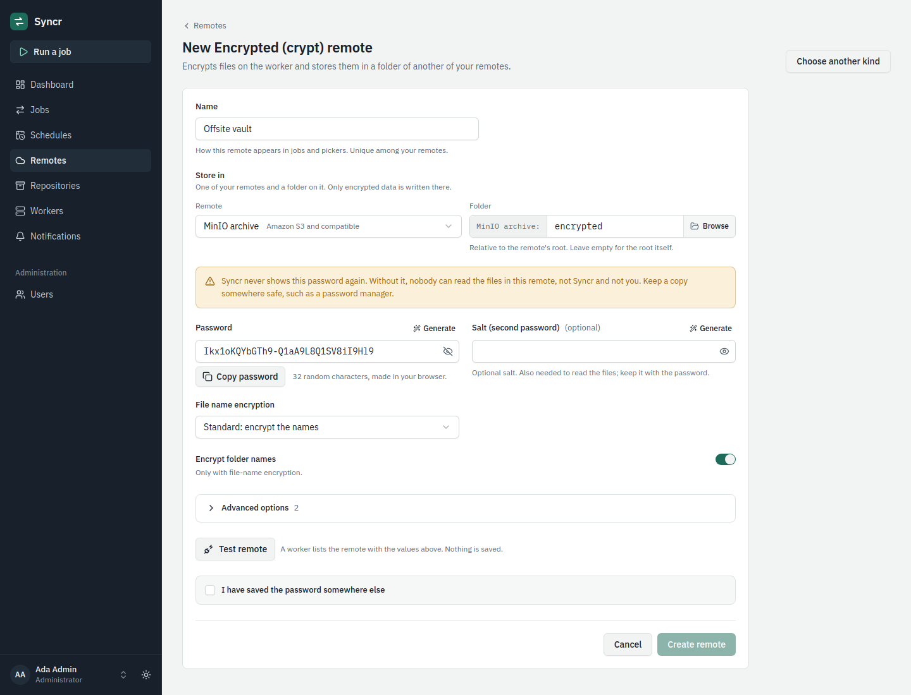

# Encrypted remotes

An **encrypted remote** (rclone's [crypt](https://rclone.org/crypt/))
encrypts files on the worker, before they leave it, and stores them in a
folder of another of your remotes. Jobs, the file browser and folder sizes
see the files as they are; the storage (a bucket, an SFTP server) only ever
holds encrypted contents and, by default, encrypted names.

```
What jobs and the browser see       What the bucket of "B2 offsite" holds
Vault: documents/taxes/2026.pdf ──► vault/p0e52nreeaj0a5ea7s64m4j72s/9f0eb7tq1kcd3m6l8ah4s2n0rg/l42g6771hnv3hn3ejbbdm6i9ec
       (the encrypted remote)         (its folder "vault": encrypted names and contents)
```

Encryption and decryption happen on the worker that runs the job. The
controller only stores the remote's settings and its passwords, encrypted
at rest with `secrets.key`, and sends them to that worker, as for any
remote's secrets.



## Creating one

Under **Remotes, Add remote**, choose **Encrypted (crypt)**:

| Field | What it is |
|---|---|
| **Store in** | One of your remotes and a folder on it (**Browse** picks one). Only encrypted data is written there. |
| **Password** | The key to the files. See [the password](#the-password). |
| **Salt (second password)** | Optional. Also needed to read the files: keep it with the password. |
| **File name encryption** | **Standard** (the default) encrypts names; **Obfuscate** hides them but keeps their length; **Off** leaves them readable. |
| **Encrypt folder names** | On by default; only with file name encryption. |
| **Name encoding** (Advanced) | How encrypted names are written: base32 (the default, safe everywhere), base64 (shorter, needs a case-sensitive remote) or base32768 (for remotes that limit name length in characters, such as OneDrive and Dropbox). |
| **Suffix** (Advanced) | Added to file names when names are not encrypted (`.bin` by default; `none` for no suffix). |

**Store in** can be any of your remotes except a **Local directory**, a
**union** or another encrypted remote ([limits](#limits)). Use a folder of
its own: anything else in it, such as files another tool wrote, makes the
encrypted remote's listings fail (Syncr has rclone refuse names it cannot
decrypt instead of skipping them).

**Test remote** lists the encrypted remote's root: with a wrong password
and data already there, the test fails.

The remote you store in shows the encrypted remote under **Used by** in the
Remotes list, and cannot be deleted until the encrypted remote is deleted
first.

## The password

The form says it above the field:

> Syncr never shows this password again. Without it, nobody can read the
> files in this remote, not Syncr and not you. Keep a copy somewhere safe,
> such as a password manager.

- **Generate** fills in a random password of 32 characters, made in your
  browser, and shows it with a copy button.
- **Create** stays disabled until you tick **I have saved the password
  somewhere else**. Generating again unticks it.
- The salt is a second password. It is optional, but if you set one, it is
  needed as much as the password: keep both together.
- Keep them **outside Syncr** too. Losing the controller's database or its
  `secrets.key` would otherwise lose the files as well; with the passwords
  you can still [read the data with rclone](#reading-the-data-without-syncr).

## What is fixed after creation

The password, the salt, **File name encryption**, **Encrypt folder names**,
**Name encoding** and **Suffix** are set when the remote is created. The
edit page shows them locked, and the API refuses another value.

They are what turns the stored data back into your files: with another
password or other name settings, the files already stored would no longer
decrypt, and new files would be written under other names beside them.
Making stored data unreadable by editing a form is not something Syncr
lets happen by accident.

- **The name and Store in can change.** Pointing Store in at another
  folder is how you follow data you moved (with the same settings).
- **The API refuses any value for a fixed secret,** even the stored one.
  Accepting an equal password would let anyone with an API token (yours, or
  a stolen one) confirm guesses of it. Forms never send the fixed secrets
  when you save an encrypted remote.
- **To change the password,** create a second encrypted remote with the
  new password in another folder, run a **Copy** job from the old one to
  the new one, check it, and then delete the old one.

## Checksums

rclone keeps **no checksums** on an encrypted remote: it cannot hash the
contents without decrypting them. So a transfer or a two-way sync with an
encrypted side **cannot compare checksums**:

- the editors do not offer it. The transfer's comparison and the two-way
  sync's **Compare files by** say "This remote keeps no checksums", and
  compare by size and modification time instead;
- the API refuses it with a field error on
  `definition.rclone_transfer.options.checksum` or
  `definition.rclone_bisync.options.compare[i]`: "is not available: a
  remote that keeps no checksums". Schedules are refused when they are
  saved, and one stored before fails when it runs.

This holds for any remote whose type keeps no checksums, not only
encrypted ones. rclone still checks each file's contents as it decrypts
it, so a damaged or tampered file fails to read.

## A wrong password

Since the password is fixed, a wrong one only happens with a **second
encrypted remote over the same folder**, made with a mistyped password,
salt or name setting. Syncr always has rclone refuse names it cannot
decrypt (`strict_names`), so a source never silently looks empty to a
transfer, a backup of a remote or a two-way sync, and a sync from it never
empties its destination.

| File name encryption | What a job reading it does |
|---|---|
| **Standard** | Listing the root fails: "undecryptable" (`execution_failed`). A folder inside it fails as not found (`not_found`), see below. |
| **Obfuscate** | Names list, garbled; reading a file fails ("bad password?"), and a sync deletes nothing. A two-way sync sees every file as changed, and its delete limit stops it. Prefer standard names. |
| **Off** | Names list as they are; reading any file fails ("failed to authenticate decrypted block - bad password?"), and a sync deletes nothing. |

**Folders on S3 and B2.** With another password, a folder's name encrypts
to another name. On SFTP that folder is missing (`not_found`), but a
bucket lists a folder that does not exist as **empty**, without an error.
So before a transfer or a backup of a remote reads a folder of an
encrypted remote, the worker looks for that folder in its parent's
listing. If it is not there, the job fails with `not_found`: *…is not in
its parent folder on the crypt remote…; if it exists, the remote's
password is wrong*. A side effect: a folder of an encrypted remote that
really does not exist is also `not_found` on S3 and B2, where a missing
folder of a plain bucket is an empty source.

**Destinations are not checked.** A copy or sync *into* an encrypted remote
with the wrong password writes its files under other encrypted names; it
neither overwrites nor deletes what the right password wrote. Checking
would cost a listing before every job for a case that only a second remote
can cause. Those files stay in the folder, though, and the right remote
cannot decrypt their names: listing its **root** then fails with
"undecryptable" (its other folders still work) until you delete them,
for example by deleting the folders the wrong remote wrote with rclone and
its settings. Delete the mistyped remote once you notice.

**The file browser** lists without that check: with a wrong password, a
folder inside an encrypted remote on S3 or B2 may show as **empty**, and
its folder size as zero. The root fails as above.

## Reading the data without Syncr

The data is ordinary rclone crypt data. With the passwords and the
settings you chose, any rclone can read it, without Syncr. Configure the
remote you store in under a name of your choice, then a crypt remote over
the same folder. Its `remote` is that remote's root as Syncr uses it (an S3
or B2 bucket, an SFTP remote's base folder) followed by the folder under
**Store in**. rclone keeps passwords obscured in its configuration:
`rclone obscure 'your password'` prints the form to paste (a new one each
time; any of them works).

```ini
# rclone.conf (rclone config file shows where yours is)
[offsite]
type = s3
provider = Cloudflare
access_key_id = <your access key ID>
secret_access_key = <your secret access key>
endpoint = https://<account id>.r2.cloudflarestorage.com

[vault]
type = crypt
# the bucket, then the folder under "Store in"
remote = offsite:my-bucket/vault
# rclone obscure '<the password>'
password = <obscured password>
# rclone obscure '<the salt>' (leave the line out if you set no salt)
password2 = <obscured salt>
# the remote's settings: these are the defaults
filename_encryption = standard
directory_name_encryption = true
filename_encoding = base32
suffix = .bin
strict_names = true
```

Then `rclone lsf vault:` lists your files and
`rclone copy vault:documents ./documents` decrypts a folder. `rclone
cryptdecode vault: <encrypted name>` tells which file an encrypted name is.

## Limits

- **No nesting.** An encrypted remote cannot store its data in a union or
  in another encrypted remote, and cannot be a union member. Each layer
  would need its own password and its own checks, and a mistake in one
  would hide the others; unions of encrypted remotes may come later.
- **Not in a worker's local folder.** A Local directory remote is a folder
  of one worker, which every user may browse on that worker; the
  encrypted remote must be stored on one of your remotes. To encrypt onto
  a disk, use a remote that reaches it (SFTP, WebDAV) instead.
- **No restic repository on an encrypted remote.** restic encrypts its
  repositories already, so a second layer would only add a password to
  lose. Put the repository on the remote you store in instead (in another
  folder). **Backups of a folder of an encrypted remote** work, through a
  mirror or a mount ([restic](restic.md#back-up-a-folder-of-a-remote)):
  restic reads the decrypted files. A backup whose source is stored in, around or inside its
  own repository's folder is refused.
- **Transfers that overlap through the wrapper are not refused,** such as
  a sync from an encrypted remote into the folder it stores its data in.
  Its foreign names then make the encrypted remote's listings fail, so it
  fails loudly. Two-way syncs are checked: their sides are compared by
  where the data is stored, and pairs on an encrypted remote wait for pairs
  on the folder it is stored in ([two-way sync](bisync.md)).
- **Changing Store in while jobs wait** leaves those queued jobs waiting
  for the old folder's other jobs, as for union members.
- **Progress counts encrypted bytes,** a little more than the files' sizes
  (a 32-byte header per file and 16 bytes per 64 KiB).

## Older workers

Workers report that they can run encrypted remotes (the `rclone.crypt`
feature) from 2.3.0. An older worker shows as **Outdated** and:

- a job on an encrypted remote sent to it fails with `worker_outdated`:
  *worker "…" must be upgraded to run jobs on remotes of type "crypt"*. A
  schedule on a label that picks such a worker fails the same way;
- folder listings, **Test remote** and folder sizes of an encrypted remote
  pick only upgraded workers; with none online, they say the workers must
  be upgraded.

Upgrade them with the command on the worker's page
([upgrading](upgrade.md)).
