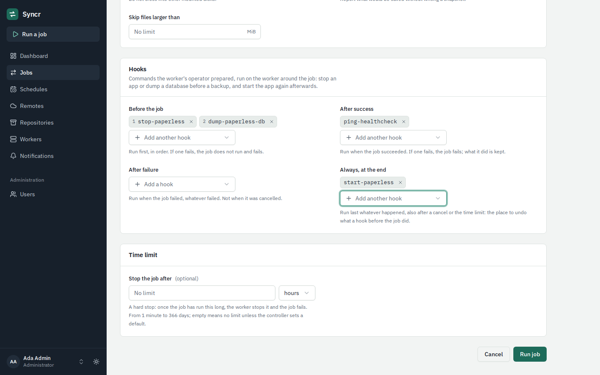
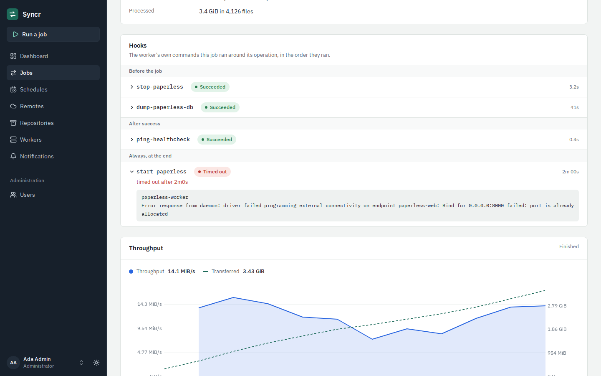

# Hooks

A hook is a command on a worker's machine that a job runs before or after
its operation: dump a database before the backup reads it, stop an
application's containers and start them again afterwards, tell a monitor
that the backup ran.

Hooks have two halves:

- **The worker's operator defines them** in the worker's configuration
  file, each under a name. Only that file says what runs.
- **A job names them.** In the web UI (or the API), whoever runs a job or
  writes a schedule picks hooks of the job's worker from a list, for each
  of four moments. Nothing else about a hook can be chosen there: no
  command, no argument, no environment value.

This split is deliberate. Every user of a controller may run jobs on every
worker, so a command typed into the web UI would let any account run
anything on any machine, as the worker's account (root, for a system
service). With named hooks the controller can only ask for something the
machine's operator already allowed.

## Defining hooks on a worker

Add a `hooks` section to the worker's configuration
(`/etc/syncr/worker.yaml` for a system install; see
[worker configuration](worker-config.md)) and restart the worker
(`sudo syncr-worker service restart`):

```yaml
hooks:
  stop-paperless:
    description: Stop the Paperless containers, so their files stay still
    command: ["docker", "compose", "-f", "/srv/paperless/docker-compose.yml", "stop"]
    timeout: 2m

  start-paperless:
    description: Start the Paperless containers again
    command: ["docker", "compose", "-f", "/srv/paperless/docker-compose.yml", "start"]
    timeout: 2m

  dump-paperless-db:
    description: Dump the Paperless database to /srv/paperless/db
    command: ["/usr/local/lib/syncr-hooks/dump-paperless-db.sh"]
    timeout: 15m
    env:
      PGPASSFILE: /etc/syncr/paperless.pgpass

  ping-healthcheck:
    description: Tell the uptime monitor that the backup ran
    command: ["curl", "-fsS", "-m", "10", "--retry", "3", "https://hc-ping.com/your-check-id"]
    timeout: 30s
```

| Setting | |
|---|---|
| name (the key) | 1 to 63 lower-case letters, digits, `.`, `_` and `-`, starting with a letter or digit. It is what users see and choose. |
| `command` | Required: the program and its arguments, as a list. The program is an absolute path, or a bare name that is found in the worker's `PATH`. |
| `description` | Optional, one line of at most 200 characters, shown next to the name in the web UI. |
| `timeout` | How long one run may take: `1s` to `24h`, default `10m`. When it passes, the hook is stopped and counts as failed. |
| `env` | Optional variables added to the command's environment. Names starting with `SYNCR_` are reserved. |

A worker defines at most 64 hooks. They cannot be set through environment
variables. An invalid `hooks` section stops the worker at startup with a
message per problem, like any other invalid setting.

At startup the worker logs the names of its hooks, and a warning for each
hook whose program it cannot find: jobs that name such a hook fail until
the program is there.

### What a hook's command gets

- **No shell.** The command is started directly, so `|`, `>`, `&&`, `$VAR`
  and wildcards mean nothing in `command`. For anything that needs a shell,
  write a script and name it, or use `["/bin/sh", "-c", "..."]`.
- **The worker's account.** A system service runs hooks as root (Linux) or
  `LocalSystem` (Windows); a per-user worker runs them as that user.
- **A small environment:** `PATH`, `HOME`, the locale, temporary directory
  and proxy settings of the worker, then the hook's own `env`, then the
  variables below. The worker's own settings and secrets (`SYNCR_WORKER_SECRET`
  and the like) are never passed on.
- **The worker's working directory.** Use absolute paths.
- **No input.** Standard input is empty: a command that asks a question
  gets no answer.

The worker tells the command about the job it runs for:

| Variable | Value |
|---|---|
| `SYNCR_HOOK_NAME` | The hook's name. |
| `SYNCR_HOOK_PHASE` | `before`, `on_success`, `on_failure` or `after`. |
| `SYNCR_JOB_ID` | The job's ID, as in the URL of its page. |
| `SYNCR_JOB_KIND` | `rclone_transfer`, `restic_backup`, `restic_restore`, `restic_forget`, `restic_prune`, `restic_check`. |
| `SYNCR_JOB_STATUS` | `running` for a hook before the job; afterwards `succeeded`, `failed` or `cancelled`. |
| `SYNCR_JOB_ERROR_CODE` | Why the job failed or was cancelled (`execution_failed`, `hook_failed`, `time_limit`, `cancelled`, `worker_shutdown`, ...); empty otherwise. |

These values are made of letters, digits, `.`, `_` and `-` only. Paths,
repository names and whatever else a user typed are deliberately not passed:
a hook that needs a path has it in its own definition.

Since one hook can serve several phases, a script can branch on them:

```sh
#!/bin/sh
# /usr/local/lib/syncr-hooks/paperless.sh, used as the hooks
# "stop-paperless" and "start-paperless" of one script
set -eu
cd /srv/paperless
case "$SYNCR_HOOK_PHASE" in
  before) docker compose stop ;;
  *)      docker compose start ;;
esac
```

Keep hook scripts where only administrators can change them (owned by root,
not writable by others): whoever can edit a script a root worker runs is
root.

## Using hooks in a job

The forms for running a job, for schedules and for restores have a
**Hooks** section once the job's worker is chosen. It offers the hooks that
worker defines, in four lists:



| List | Runs | If a hook fails |
|---|---|---|
| **Before the job** (`before`) | First, in the order listed. | The rest of the list and the job's operation are skipped, and the job fails. |
| **After success** (`on_success`) | After the operation succeeded, in order. | The job fails; what the operation did is kept (a backup's snapshot exists). |
| **After failure** (`on_failure`) | After the job failed, whatever failed: a hook, the operation or the time limit. Not after a cancel. | Noted on the job's page; all of them run. |
| **Always, at the end** (`after`) | Last, whatever happened, also after a cancel or the time limit. | All of them run. A job that had succeeded fails; a job that had already failed or was cancelled stays as it was. |

A list holds up to 8 hooks, each at most once. A hook succeeds when its
command exits with code 0.

Put what must be undone into **Always, at the end**: if `stop-paperless`
runs before a backup, `start-paperless` belongs there, so the application
comes back when the backup fails, is cancelled or runs into its time limit
too. Hooks at the end run even if a hook before the job failed, so they
should cope with finding nothing to undo.

A job that fails because of a hook has the error code `hook_failed`, names
the hook in its message, and notifies like any failed job. Its page lists
every hook that ran, with its exit code, duration and the last 4 KiB of
what it printed. That output is shown to everyone who can see the job, so a
hook should not print secrets.



Cancelling a job, its time limit and stopping the worker stop a hook that
runs before the job or after its success, like they stop rclone or restic:
on Linux the command gets an interrupt (SIGINT) and five seconds to exit
before it and every process it started are killed; on Windows it is killed
at once. A job's time limit counts from the moment it starts, hooks before
it included. Hooks after a failure and at the end are bounded by their own
timeouts only, so that a cancel cannot stop the clean-up halfway.

### Where a job with hooks can run

- **On one worker:** the worker must define every hook the job names. The
  web UI and the API refuse the job otherwise and say which hook is
  missing. If the hook is removed from the worker later, the job fails with
  `invalid_spec` before anything runs, and a schedule pauses itself with
  the reason.
- **On any worker with a label:** only workers that define every hook
  qualify. Hooks of the same name on different workers are the same hook as
  far as Syncr is concerned: give them the same meaning. If no worker with
  the label defines them all, the run fails like a label without workers.
- A worker older than this feature cannot run hooks: the job fails with
  `worker_outdated` rather than running without them.
  [Upgrade the worker](upgrade.md).

## Examples

### A database: dump, then back up the dump

Backing up a running database's files gives a snapshot that may not start.
Dump it first into a folder inside the backup's paths:

```sh
#!/bin/sh
# /usr/local/lib/syncr-hooks/dump-paperless-db.sh
set -eu
out=/srv/paperless/db
mkdir -p "$out"
docker exec paperless-db pg_dump -U paperless -Fc paperless > "$out/paperless.dump.tmp"
mv "$out/paperless.dump.tmp" "$out/paperless.dump"
```

The backup job names `dump-paperless-db` under **Before the job** and
includes `/srv/paperless/db` in its paths (the folder must be inside the
worker's `local_roots`). If the dump fails, no backup runs and you are
notified, instead of keeping a snapshot with a stale or half-written dump.
For MySQL or MariaDB use `mysqldump --single-transaction`; for SQLite,
`sqlite3 app.db ".backup '/srv/app/db/app.db'"`.

### Docker containers: stop, back up, start

For an application whose files only make sense while it is stopped:

- **Before the job:** `stop-paperless`
- **Always, at the end:** `start-paperless`

Both can be combined with the dump: `stop-paperless`, then
`dump-paperless-db` needs the database container running, so either dump
first and stop afterwards, or stop only the application's containers.

A worker that itself runs in a container has no `docker` program and no
access to the Docker socket. Hooks that manage containers belong on a
worker installed on the host ([Linux setup](setup-linux.md)).

### Restores

A restore can name hooks too: stop the application before its files are
replaced, and afterwards start it or load a dump
(`pg_restore --clean -d paperless /srv/paperless/db/paperless.dump`). Define
those as separate hooks, so that nobody loads a dump by choosing the wrong
hook for a backup.

### Windows

`command` needs a program, and scripts are run by their interpreter:

```yaml
hooks:
  stop-app:
    description: Stop the application's service
    command: ['C:\Windows\System32\WindowsPowerShell\v1.0\powershell.exe', '-NoProfile', '-NonInteractive', '-ExecutionPolicy', 'Bypass', '-File', 'C:\ProgramData\Syncr\hooks\stop-app.ps1']
    timeout: 2m
```

Single quotes keep the backslashes literal. A PowerShell script reports
failure with `exit 1`. For open files, a backup's **Use a volume snapshot**
option is often enough and needs no hook ([restic backups](restic.md)).

## Limits and known gaps

- While a hook runs, the job's page shows the job as running without
  saying which hook: the hooks appear once the job has ended.
- The clean-up hooks (after failure, at the end) cannot be cancelled from
  the web UI; their timeouts bound them. Choose timeouts accordingly.
- When the worker is stopped, a running job is cancelled and its hooks at
  the end still run, but the whole stop is limited to about 12 seconds.
  A hook that needs longer is killed with the worker. If the worker crashes
  or the machine loses power, nothing runs: check after such a restart that
  what a hook stopped is running again.
- A job that was queued again after its worker restarted runs its hooks
  again, from the start.
- Hooks run for the jobs users start and schedule. The listing, browsing
  and testing the web UI does on a worker, and deleting a repository's data,
  run none.
- There is no command yet to try a hook by hand from the worker's command
  line: run its command yourself, as the worker's account.
