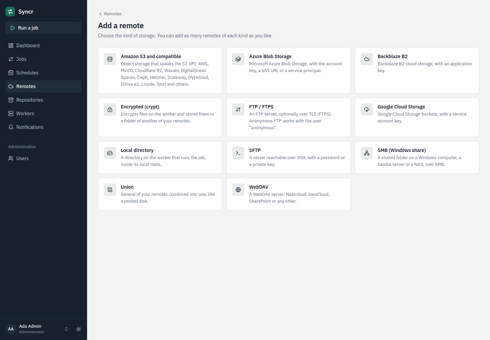
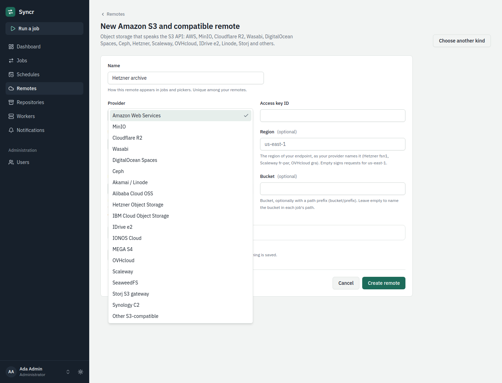
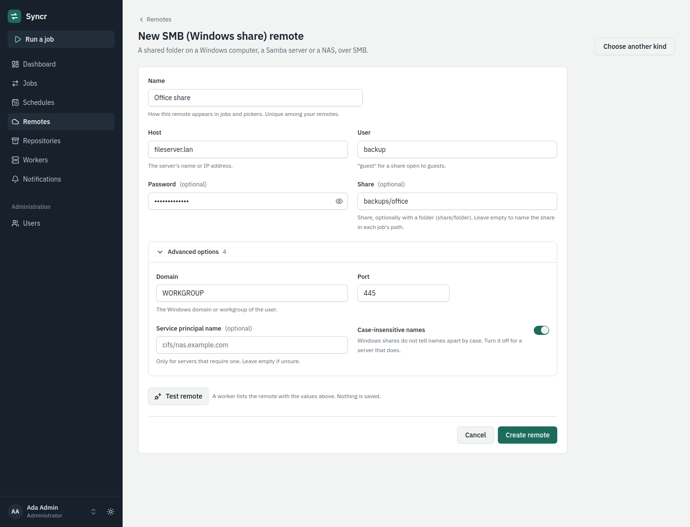
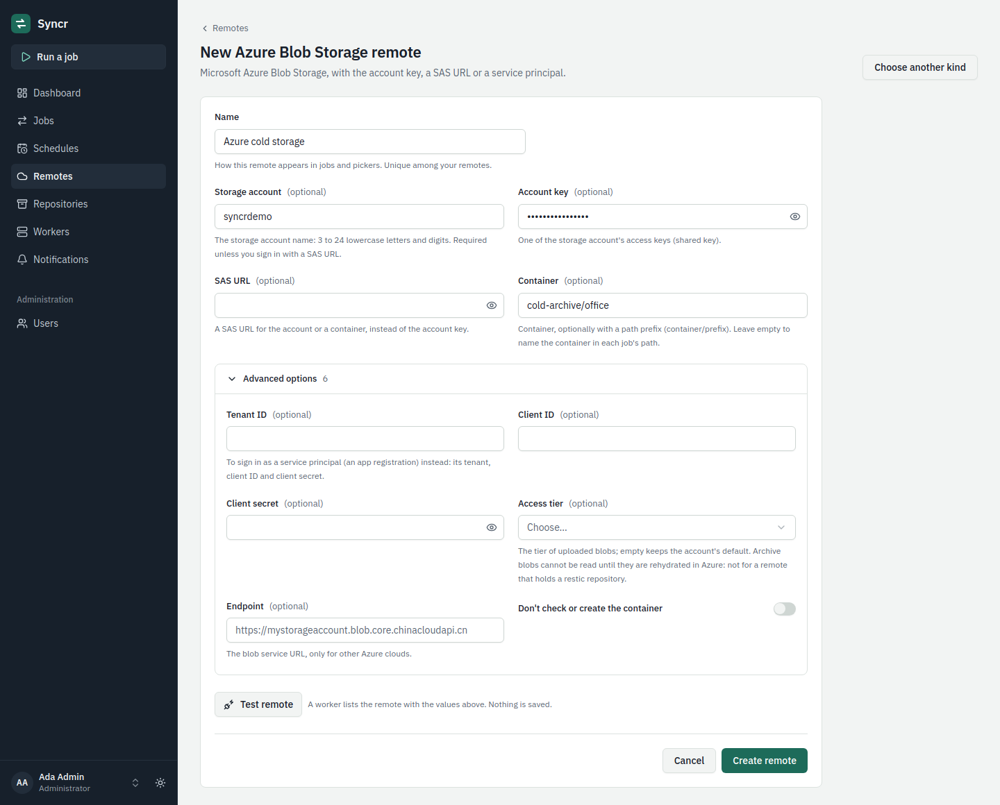
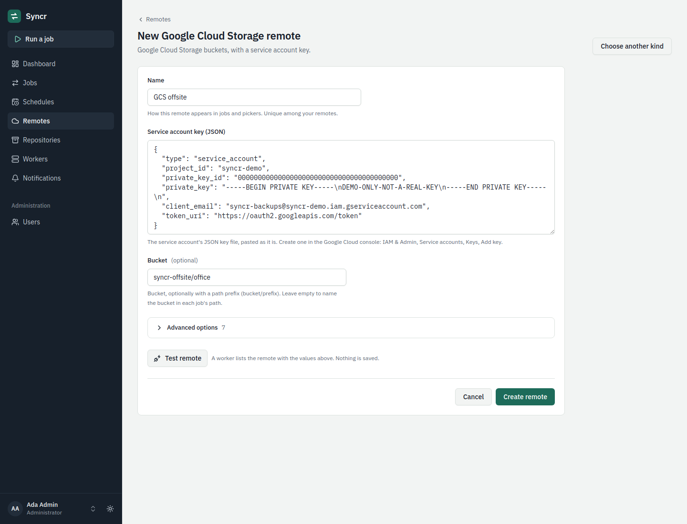
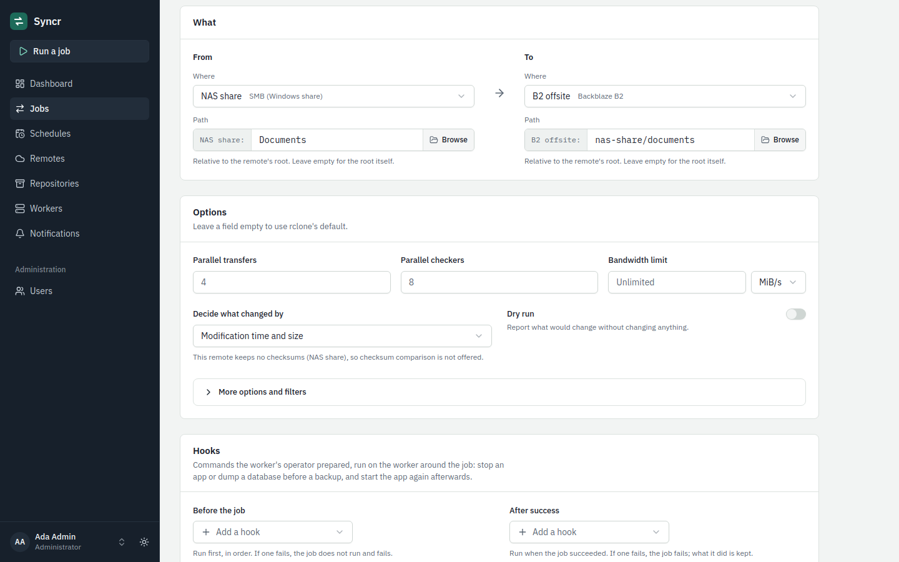
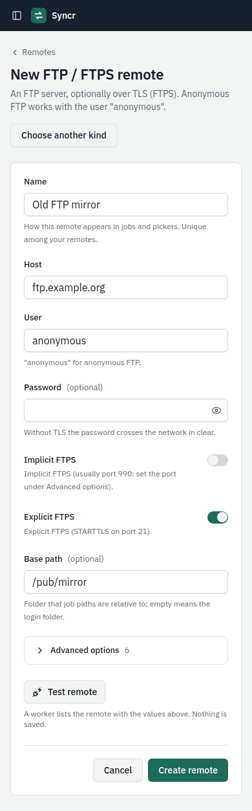

# Remotes

A **remote** is a place jobs read from and write to: a bucket, a server, a
share, or a folder on a worker. Add one under **Remotes, Add remote** and
pick its type. The form comes from the type: required fields first, the
rest under **Advanced options**. **Test remote** lists the remote's root on
a worker before you save.

Remotes are private: only their owner sees and uses them, admins included.
Passwords, keys and other secrets are write-only: Syncr stores them
encrypted with `secrets.key`, never shows them again ("Saved"), and sends
them only to the worker that runs a job. To change one, type a new value;
to keep it, leave the field empty.

| Type | For | Checksums | Restic repositories | Union member | Workers |
|---|---|---|---|---|---|
| [Amazon S3 and compatible](#amazon-s3-and-compatible) | AWS and S3-compatible services | yes | yes | yes | all |
| [Azure Blob Storage](#azure-blob-storage) | Microsoft Azure | yes (MD5) | yes | yes | 2.3.0 or later |
| [Backblaze B2](#backblaze-b2) | Backblaze B2 | yes | yes | yes | all |
| [Encrypted (crypt)](encrypted-remotes.md) | encryption on the worker, into another remote | **no** | no | no | 2.3.0 or later |
| [FTP / FTPS](#ftp--ftps) | FTP servers, with or without TLS | **no** | yes | yes | 2.3.0 or later |
| [Google Cloud Storage](#google-cloud-storage) | GCS buckets, with a service account key | yes (MD5) | yes | yes | 2.3.0 or later |
| [Local directory](#local-directory) | a folder on the worker that runs the job | yes | yes | yes | all |
| [SFTP](#sftp) | any server reachable over SSH | yes | yes | yes | all |
| [SMB (Windows share)](#smb-windows-share) | Windows shares, Samba, NAS boxes | **no** | yes | yes | 2.3.0 or later |
| [Union](#union) | several remotes combined into one | as its members | no | no | all |
| [WebDAV](#webdav) | Nextcloud, ownCloud, SharePoint, others | depends on the server | yes | yes | all |

A path in a job, a schedule or the file browser is relative to the
remote's root: the bucket, share, container or base path you set, or, when
you leave that empty, the top of the storage (then the first folder of the
path is the bucket, share or container).

## The types you know from 2.2

### Amazon S3 and compatible

**Provider**, **Access key ID**, **Secret access key**, **Region**,
**Endpoint** and an optional **Bucket** (with a path prefix:
`bucket/prefix`). Advanced: location constraint, canned ACL, storage
class, server-side encryption, path-style URLs, and not checking or
creating the bucket.

The providers are Amazon Web Services, MinIO, Cloudflare R2, Wasabi,
DigitalOcean Spaces, Ceph, and from 2.3.0 also the ones below. Each
endpoint is one of those rclone knows for the provider (pick the one of
your region), and each region is the one rclone gives for that endpoint:

| Provider | Endpoint, for example | Region with it |
|---|---|---|
| Akamai / Linode | `https://nl-ams-1.linodeobjects.com` | empty |
| Alibaba Cloud OSS | `https://oss-eu-central-1.aliyuncs.com` | empty |
| Hetzner Object Storage | `https://fsn1.your-objectstorage.com` | `fsn1` (`hel1`, `nbg1` for the other two) |
| IBM Cloud Object Storage | `https://s3.eu-de.cloud-object-storage.appdomain.cloud` | empty |
| IDrive e2 | the endpoint shown with your access key | empty |
| IONOS Cloud | `https://s3.eu-central-1.ionoscloud.com` | `de`, rclone's name for Frankfurt (for the other endpoints, the name in them: `eu-central-2`, `eu-central-3`, `eu-central-4`, `eu-south-2`, `us-central-1`) |
| MEGA S4 | `https://s3.eu-amsterdam-1.megas4.com` | empty |
| OVHcloud | `https://s3.gra.io.cloud.ovh.net` | `gra` (the name in the endpoint: `rbx`, `sbg`, `de`, `uk`, `waw`, …) |
| Scaleway | `https://s3.fr-par.scw.cloud` | `fr-par` (`nl-ams`, `pl-waw`) |
| SeaweedFS | your server's S3 address, e.g. `http://seaweedfs.lan:8333` | empty |
| Storj S3 gateway | `https://gateway.storjshare.io` | empty |
| Synology C2 | `https://eu-001.s3.synologyc2.net` | `eu-001` (the name in the endpoint: `eu-002`, `us-001`, `us-002`, `tw-001`) |
| Other S3-compatible | the service's S3 address | as the service documents it |

"Empty" means rclone's own setup asks for no region for that provider,
or suggests none: leave **Region** empty. rclone then signs requests for
`us-east-1`, as it does for its own users of those providers. A provider
that checks the region refuses requests signed for another one, so set it
wherever the table names one.

**The endpoint is required unless the provider is AWS.** Without one,
rclone sends every request, signed with your key, to AWS. Endpoints often
depend on the region: your provider's documentation lists them. The
provider choice tells rclone the service's quirks (path-style URLs, how it
lists, which headers it takes), so pick yours rather than **Other** when
it is in the list.

### Backblaze B2

**Key ID** and **Application key** (an application key from the Backblaze
console; restricting it to one bucket is a good idea), and an optional
**Bucket** with a path prefix. Advanced: endpoint, a download URL (a CDN in
front of the bucket), deleting files permanently instead of hiding old
versions, and including old versions.

### SFTP

**Host**, **Port** (22), **User**, and a **Password**, a **Private key**
(PEM, pasted) or both, with an optional passphrase. **Server host keys**
are the server's public keys, one per line, as in a `known_hosts` line
without the host name; **Fetch from server** reads them for you. With
them, a server that offers another key is refused; without them, the server is
not verified. **Base path** is the folder job paths start in; empty is the
login folder.

### WebDAV

**URL** (the WebDAV root; job paths are relative to it), **Vendor**
(Nextcloud, ownCloud, SharePoint, or other), **User** and **Password**, or
a bearer token under advanced. Checksums depend on the vendor: Nextcloud
and ownCloud keep them, "other" servers usually do not offer any rclone
can use.

### Local directory

**Path**: an absolute path on the worker that runs the job, inside that
worker's `local_roots` ([worker configuration](worker-config.md#local-folders)).
The same remote means a different disk on each worker.

### Union

Several of your remotes combined into one, like a pooled disk: **Members**
(at least two, each a remote, a path on it and a mode: read-write,
read-only, or no new files) and the policies that pick which member a
change, a new file or a read goes to. A union cannot hold a restic
repository or be another union's member. It keeps checksums only when all
of its members do ([checksums](#checksums)).

## New in 2.3.0

These types need a **2.3.0 or later worker**
([older workers](#older-workers)).

### Encrypted (crypt)

A remote that encrypts files on the worker and stores them in a folder of
another of your remotes. See [encrypted remotes](encrypted-remotes.md).

### SMB (Windows share)

A shared folder on a Windows computer, a Samba server or a NAS, over SMB.

| Field | What to enter |
|---|---|
| **Host** | The server's name or IP address: `nas.local`, `192.168.1.20`. |
| **User** | The account on the server: `backup`. For a share open to guests, `guest` with no password. Required: the worker never sends its own account name. |
| **Password** | The account's password. |
| **Share** | The share, optionally with a folder: `family` or `family/photos`. Leave it empty to name the share as the first folder of each job's path (`family/photos/2026`). |
| **Domain** (Advanced) | The Windows domain or workgroup of the user; `WORKGROUP` by default. |
| **Port** (Advanced) | 445. |
| **Service principal name** (Advanced) | Only for servers that require one (`cifs/nas.example.com`). Leave it empty if unsure. |
| **Case-insensitive names** (Advanced) | On by default, as Windows shares do not tell names apart by case. Turn it off for a server that does. |

A share is what the server calls it, not a drive letter or a Windows path:
`\\nas\family\photos` is host `nas`, share `family/photos`.

**Use SMB on networks you trust.** Syncr signs in with NTLM (a user name
and a password); unlike SFTP's host keys, nothing verifies the server's
identity, so a machine that takes the server's name or address on your
network could receive the files. Kerberos sign-in is not supported.

SMB keeps **no checksums** ([checksums](#checksums)). Modification times
are kept to the millisecond, so copies and two-way syncs compare by size
and modification time as usual.

### FTP / FTPS

An FTP server, optionally over TLS (FTPS).

| Field | What to enter |
|---|---|
| **Host** | `ftp.example.com`. |
| **User** | The account on the server; `anonymous` for anonymous FTP. Required: the worker never sends its own account name. |
| **Password** | The account's password. |
| **Implicit FTPS** | TLS from the first byte, usually on port 990: set **Port** under advanced options too. |
| **Explicit FTPS** | Plain FTP that switches to TLS before signing in (STARTTLS), on port 21. |
| **Base path** | The folder job paths start in: `/pub/backups`. Empty is the login folder. |
| **Port** (Advanced) | 21. |
| **Don't verify the server certificate** (Advanced) | Accepts any certificate. Anyone between the worker and the server can then read and change the traffic: only for a test server. |
| **Connections** (Advanced) | The most connections at once; empty or 0 means no limit. For servers that allow only a few per user. Too low a limit can make jobs hang: see **Connection limit** below. |
| **Disable EPSV**, **Disable MLSD**, **Set times with MDTM** (Advanced) | For servers that need them. |

Choose one of the two FTPS options, not both. **Without either, FTP sends
the user name, the password and every file in clear**: anyone on the way
can read them. Prefer explicit FTPS when the server offers it, or
[SFTP](#sftp) when the server runs SSH.

**Anonymous FTP:** user `anonymous`. The worker always sends a password,
an empty one when you set none. Servers that want an e-mail address as the
anonymous password refuse an empty one: enter any address then.

**Connection limit.** Leave **Connections** empty unless the server
limits connections. rclone warns that a limit can make a job hang (a
deadlock: it stops making progress until it is cancelled or reaches its
time limit) unless the limit is at least **one more than the job's
parallel transfers plus its parallel checkers**: 13 with the defaults
(4 transfers, 8 checkers). This holds for copies, syncs and moves,
two-way syncs, and
[mirror backups of a folder](restic.md#back-up-a-folder-of-a-remote) of
the remote, which always run 8 checkers, so they need their **Parallel
downloads** plus 9. On a server that allows only a few connections per
user, set **Connections** to its limit and lower the job's **Parallel
transfers** and **Parallel checkers** to fit: with 4 connections, 1
transfer and 2 checkers. Syncr does not check this for you.

**Modification times.** rclone compares FTP files by modification time
only when the server can both report times (MLSD or MDTM) and set them
(MFMT). vsftpd sets them with MDTM instead of MFMT: turn on **Set times
with MDTM** for it. A server that cannot set times keeps none rclone can
use, even when it lists them (rclone's own `rclone serve ftp` is one). On
such a server:

- copies, syncs and two-way syncs compare **by size only**, so a file
  changed on the server without changing its size is **not** seen as
  changed, and is not copied or synced;
- a [backup of a folder of the remote](restic.md#back-up-a-folder-of-a-remote)
  with the **mirror** method misses the same changes: the mirror keeps
  the old file, so every later snapshot keeps the old content, and the
  job still succeeds;
- a two-way sync with an FTP side warns on every run that "Modtime compare
  was requested but at least one remote does not support it". The run
  still works: new files, size changes and deletions spread both ways.

What to do on such a server:

- Use SFTP or WebDAV instead when the server offers them. On vsftpd, turn
  on **Set times with MDTM**: rclone then compares times as usual.
- Back the folder up with the **mount** method. The mount shows restic
  the times the server lists, and restic reads a file again when its
  time or size changed. That catches a change to the second on servers
  that list exact times (MLSD or MDTM), but only to the minute (to the
  day for files older than about six months) on servers that list times
  only in their plain listing (LIST).
- Or keep the mirror method and turn on **Delete the mirror after each
  run**. The next run still backs up the mirror it has, then deletes it;
  every run after that downloads the whole folder, and the fresh copy has
  the times the server lists, so restic sees the same changes as with the
  mount, at the cost of a full download each time.

FTP keeps **no checksums** either ([checksums](#checksums)).

### Azure Blob Storage

Microsoft Azure Blob Storage. Sign in with **exactly one** of:

| Sign-in method | Fields |
|---|---|
| **Shared key** | **Storage account** (`mystorageaccount`) and **Account key** (one of the account's two access keys, under *Security + networking, Access keys* in the Azure portal). |
| **SAS URL** | **SAS URL** only: a shared access signature URL for the account or a container (`https://mystorageaccount.blob.core.windows.net/backups?sv=…&sig=…`). With a container's SAS URL, enter that container under **Container**: the signature reaches no other. |
| **Service principal** (Advanced) | **Storage account**, plus the app registration's **Tenant ID**, **Client ID** and **Client secret**. Give the app the *Storage Blob Data Contributor* role on the account or the container. |

A form with none, or with two methods, is refused ("use one sign-in
method: the account key, a SAS URL or a service principal"); a service
principal without one of its three fields names the missing ones.
Anonymous access to public containers is not supported, and the worker
never uses its host's Azure identity (managed identity, the Azure CLI or
environment credentials).

The other fields:

| Field | What to enter |
|---|---|
| **Container** | The container, optionally with a path prefix: `backups` or `backups/office`. Leave it empty to name the container in each job's path. |
| **Access tier** (Advanced) | Hot, Cool, Cold or Archive for uploaded blobs; empty keeps the account's default. Blobs in Archive must be rehydrated in Azure before anything can read them, restic included. **Do not choose Archive for a remote that holds a restic repository:** restic reads the repository's own files (its config and keys) on every run, so a repository created there cannot be used until they are rehydrated. |
| **Endpoint** (Advanced) | Only for other Azure clouds: the **full blob service URL**, such as `https://mystorageaccount.blob.core.chinacloudapi.cn`, not a host name or a suffix. |
| **Don't check or create the container** (Advanced) | For keys or SAS URLs that may not list or create containers. |

Azure keeps MD5 checksums.

### Google Cloud Storage

Google Cloud Storage buckets, signed in with a **service account key**.

| Field | What to enter |
|---|---|
| **Service account key (JSON)** | The whole JSON key file of a service account, pasted as it is (line breaks included). |
| **Bucket** | The bucket, optionally with a path prefix: `syncr-backups` or `syncr-backups/office`. Leave it empty to name the bucket in each job's path. |
| **Project number** (Advanced) | Needed only to list buckets (an empty **Bucket**) or create them. |
| **Location**, **Storage class** (Advanced) | Where new buckets are created and the class of new objects; empty for Google's defaults. |
| **Uniform bucket-level access** (Advanced) | **On by default.** rclone then sends no access lists (ACLs), so uploads work on buckets with uniform bucket-level access, which the Google Cloud console creates by default and which refuse ACLs, and on buckets with fine-grained access too (new objects then get the bucket's default object ACL). Buckets rclone creates get uniform access. Turn it off only to set the ACLs below on a bucket with fine-grained access. |
| **Object ACL**, **Bucket ACL** (Advanced) | Access lists for new objects and buckets, only with uniform bucket-level access off; empty for private. |
| **Endpoint** (Advanced) | Another storage API endpoint, e.g. a private one. Leave it empty normally. |

**Making a key**, in the Google Cloud console:

1. **IAM & Admin, Service accounts, Create service account.** Give it a
   name such as `syncr-backups`; it needs no project-wide role.
2. Open the bucket (**Cloud Storage, Buckets**), **Permissions, Grant
   access**: the service account's e-mail address, with the role
   *Storage Object Admin* (read, write and delete objects in that bucket
   only). To list or create buckets as well, it needs *Storage Admin* on
   the project, and the form needs the **Project number**.
3. Back on the service account, **Keys, Add key, Create new key, JSON**.
   The browser downloads the key file. Paste its contents into the form,
   then delete the file or keep it somewhere safe: it signs in as the
   service account until you delete the key in the console.

Some organisations forbid service account keys (the policy
`iam.disableServiceAccountKeyCreation`); an administrator must allow them
for the project.

**What Syncr accepts.** The key must be a service account key
(`"type": "service_account"`) with a `client_email` and a `private_key`.
Other credentials (user accounts, workload identity federation's
`external_account` files) are refused. Its `token_uri`, where the worker
sends the signed sign-in request, must be absent (or empty) or exactly
`https://oauth2.googleapis.com/token`, as in every key Google makes; any
other address is refused, when the remote is saved and again by the
worker, so a key cannot send the worker's sign-in elsewhere. The messages
never repeat any part of the key. The worker never uses its host's Google
credentials (gcloud's or the metadata server's): without a key, a Google
Cloud Storage remote is refused.

Google Cloud Storage keeps MD5 checksums.

## Checksums

A transfer can decide what changed by checksum, and a two-way sync can add
the checksum to its comparison, only when **both sides keep checksums**.
These keep none:

- **SMB** and **FTP / FTPS** remotes;
- **encrypted (crypt)** remotes;
- a **union** with an SMB or FTP member (an encrypted remote is never a
  union member).

With such a side, the editors do not offer checksum comparison and say
"This remote keeps no checksums", naming it; the API refuses it with
"is not available: a remote that keeps no checksums", and a schedule that
compares checksums is refused when it is saved.

Types that do keep checksums do not all keep the same kind: S3 and Azure
and Google Cloud Storage keep MD5, B2 SHA-1. A comparison by checksum
uses one only when **both files have a checksum of the same kind**;
otherwise a copy, sync or move compares the two files **by size only**.
That is the case:

- between two types with no kind in common, such as S3 and B2;
- for a file that has **no checksum stored**, even between two types
  that keep the same kind. rclone stores one with a file it uploads in
  parts only when the source has a checksum of that kind, so large files
  copied to S3, Azure or B2 from a remote without that kind have none
  (S3 and B2 upload files of about 200 MiB or more in parts, Azure files
  over 4 MiB): files copied from an encrypted, SMB or FTP remote, for
  example, or between B2 and S3 or Azure. Files uploaded in parts by
  other tools may have none either.

A file changed without changing its size then looks unchanged to a copy
that compares by checksum, which skips it. A two-way sync that compares
size and checksum, but not modification time, misses the same change on
a side where the file has no checksum stored. Comparing by size and
modification time (the default) still sees such a change when the
file's time changed with it. A comparison by checksum is not proof
that two copies are the same.

## Older workers

Workers report which of the new types they can run (the features
`rclone.backend.smb`, `rclone.backend.ftp`, `rclone.backend.azureblob` and
`rclone.backend.gcs`) from 2.3.0. An older worker shows as **Outdated**,
and:

- a job on an SMB, FTP, Azure or Google Cloud Storage remote sent to it,
  directly or through a union member or an encrypted remote, fails with
  `worker_outdated`: *worker "…" must be upgraded to run jobs on remotes
  of type "smb"*. A schedule on a label that picks such a worker fails the
  same way;
- folder listings, **Test remote** and folder sizes of such a remote pick
  only upgraded workers; with none online, they say the workers must be
  upgraded.

Upgrade them with the command on the worker's page
([upgrading](upgrade.md)). Remotes of the other types work on every 2.x
worker.

## What a remote can reach

A worker connects to whatever host a remote names: an SFTP or FTP server,
an SMB share, a WebDAV URL or an S3 endpoint, also on the worker's own
network. Every signed-in user may run jobs on every worker, so only give
accounts to people you would let reach those networks. What a remote can
never do is run a command on the worker, read the worker's own files
outside its `local_roots`, or sign in with the worker's identity (its
account name, its Google, Azure or AWS credentials).

