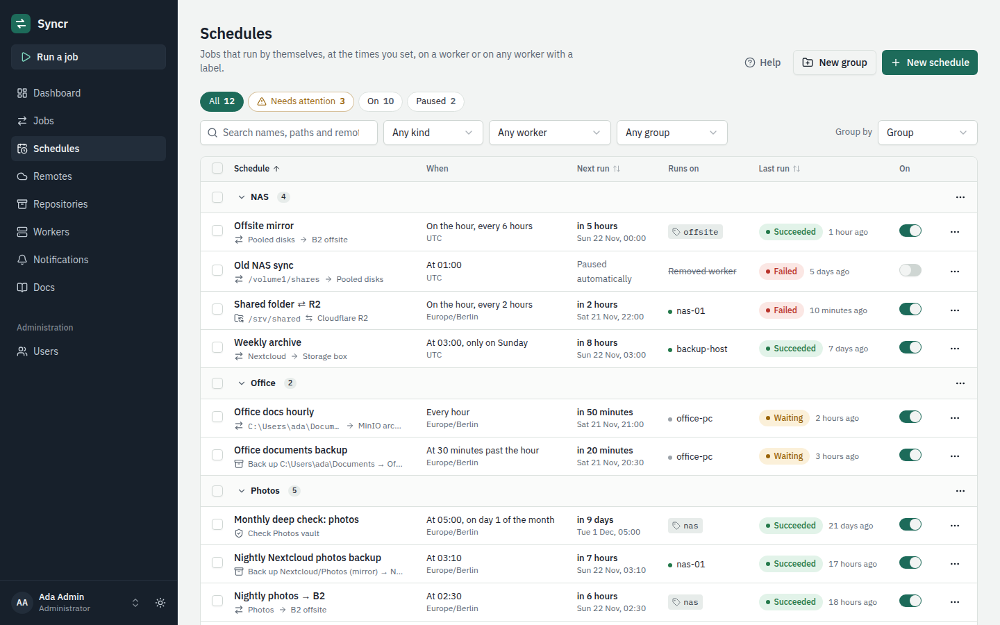
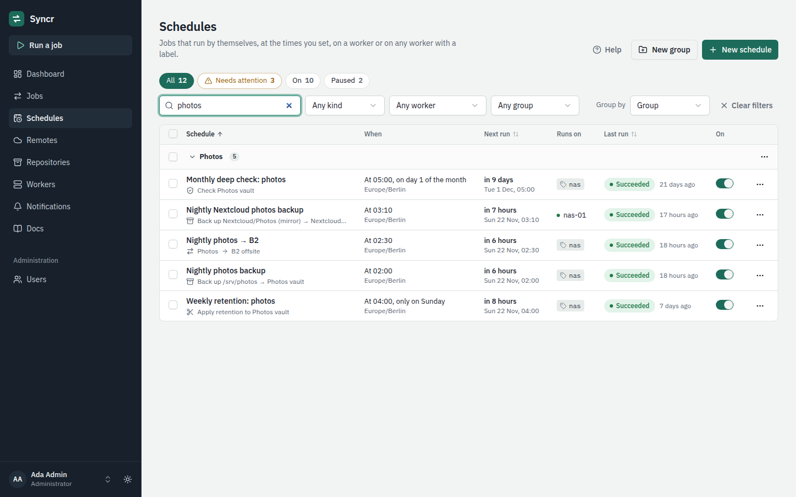
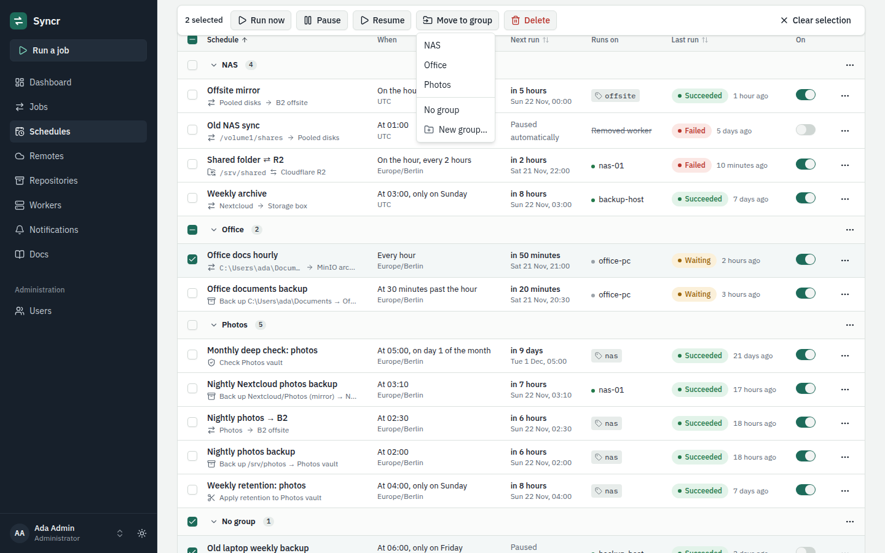

# Schedules

A schedule runs a job by itself, at the times a cron expression gives in a
time zone, on one worker or on any worker with a label. When its worker is
offline at that time, the run waits for it within the deadline you set, and
runs once when it is back. The schedule form explains each setting next to
it; this page is about the **Schedules** list: finding schedules, keeping
them in groups and acting on several at once.

## The schedule list

Each row shows the schedule's name and what it runs: the kind's icon, then
the two locations of a transfer or a two-way sync, or what a restic job
does on which repository. Then when it runs, its next run, where it runs,
how its last run went, and a switch that pauses or resumes it.

- **Status:** the buttons above the list count your schedules, and narrow
  the list to them:
  - **Needs attention:** Syncr paused it (its worker was removed, a remote
    or repository it uses was deleted, its worker cannot run it), or it is
    on and its last run was missed, could not start, failed or was
    interrupted. A run or a job someone cancelled does not count.
  - **On** and **Paused:** whether it runs. A schedule Syncr paused is
    paused and needs attention.
- **Search** looks in names and descriptions, groups, when a schedule runs
  (in words and as the expression), what it runs (kinds, remotes, paths and
  repositories) and where (worker names and labels). Several words must
  all match.
- **Filters:** the kind, the worker or label it runs on, and the group.
- **Sort:** click **Schedule**, **Next run** or **Last run** at the top of
  the list, and again to reverse the order. Schedules without a next run
  (paused ones) or without a last run come last either way.
- **Group by:** the list is in sections by group, or by worker, kind or
  status, or in none. Click a section's heading to fold it; the browser
  remembers the folded sections.

The filters, the sort and the grouping are part of the page's address, so
a list you look at often can be bookmarked.

## Groups

A group is a named set of your schedules, such as *Photos* or *Office PC*.
A schedule is in one group or in none.

- **Groups only organize the list.** They change nothing about when or
  where a schedule runs, whom it notifies, or how its runs are counted.
  Pausing a group's schedules pauses each of them, as below; the group has
  no switch of its own.
- **Groups are yours.** Like schedules, nobody else sees them,
  administrators included. A name is at most 64 characters and unique
  among your groups, ignoring case.
- **Create one** with **New group** above the list, with **Move to group,
  New group…** on schedules, or from **Group** on the schedule form.
- **Put a schedule in one** with **Group** on its form, or **Move to
  group** in its menu or for a selection (below). **New schedule in this
  group**, in a group's menu, starts the form with the group chosen.
- **Rename or delete** a group from its menu, on its heading. Deleting a
  group keeps its schedules: they stay, in no group, and run as before.

A group without schedules is still listed while no filter is set, so you
can fill, rename or delete it. A schedule's page shows its group; click it
to list the group's schedules.

## Several schedules at once

Tick schedules, a section's heading or the box at the top of the list, and
act on them together: **Run now**, **Pause**, **Resume**, **Move to group**
and **Delete**. Only the schedules on the list count: a filter that hides a
ticked schedule leaves it out.

- Each schedule is its own request: one that fails does not stop the
  others, and the message names those that failed. **Run now** fails, for
  example, on a schedule whose last run is still going when it skips runs
  that overlap.
- **Pause** and **Resume** leave out the schedules that are already paused
  or on. Resuming checks each schedule as saving it would, so one whose
  worker or remote is gone stays paused.
- **Move to group** moves all of them or, if one cannot be moved, none.
- **Delete** asks first. Their run history goes with them; the jobs they
  ran stay in the job list.

A section's menu does the same for the whole section: **Run all now**,
**Pause all** and **Resume all**.

Moving a schedule, or deleting its group, counts as a change of the
schedule: saving an edit of it opened before then is refused (*Someone else
changed this in the meantime*), as when someone else saved it first. Reload
the form and edit again.

## In metrics and the API

- `syncr_schedule_info` names each schedule's group in its `group` label
  (empty for none), so alerts can be routed by group
  ([metrics](metrics.md#schedules)).
- Groups are in the API's `ScheduleService` (`ListScheduleGroups`,
  `CreateScheduleGroup`, `RenameScheduleGroup`, `DeleteScheduleGroup`
  and `MoveSchedules`) and a schedule's `groupId`
  ([scripting the API](api.md#schedule-groups)).
